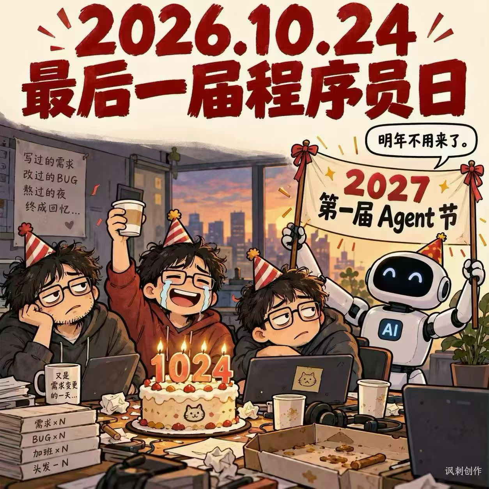

+++
date = '2026-10-24T22:07:44+08:00'
draft = false
title = '2026.10.24 随笔'
summary = ''
tags = []
categories = []
+++

今天是10.24，一个属于程序员的节日，今天朋友圈看到最有意思的一条信息是，一张配图，“程序员的最后一次节日，Agent的第一次节日”。想想还是蛮感慨的，这几年随着大模型的风起云涌，不管是技术圈子还是我个人的职业生涯都发生了巨大的变化。

上次认真的写Blog还是12年-13年，那时候刚毕业，每天不管多晚下班都会一边看技术，一边写Blog，一方面加深对技术的理解，一方面也算是沉淀自己在圈子里面的影响力，可惜一次意外导致所有Blog被删除之后就没认真开始写。一方面是因为忙，另一方面可能也是总觉得思考的还不够深入，所以也没必要写出来。特别是最近两年大模型越来越强，越来越感觉自己可以输出的“术”的东西越来越少，而很多“道”的东西怎么合适的分享，又很难拿捏到度。  
因为看到那张配图，突然还是想找块自留地，可以和模型一起 co-work写一些东西，算是一点自留地~~，写写自己日常的心得和体会吧~  
索性晚上用Claude & DS快速帮我折腾了一个github blog, 看了下DS的消费记录，花费0.3元，算是回应了上面的那张图。
